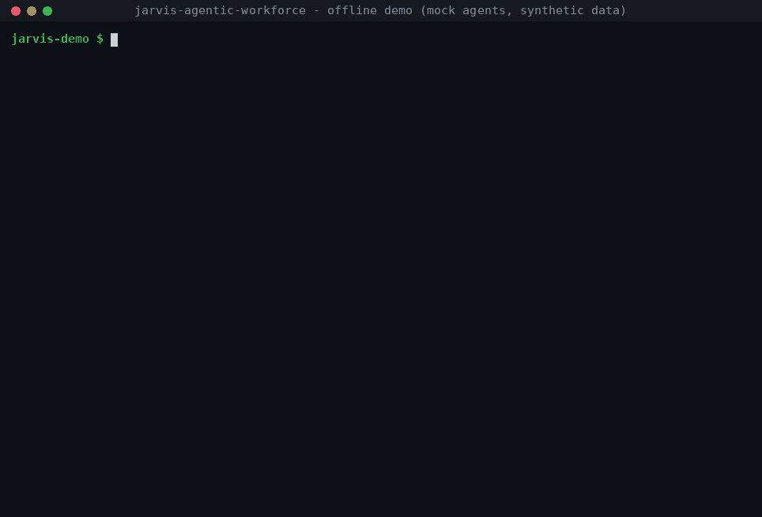
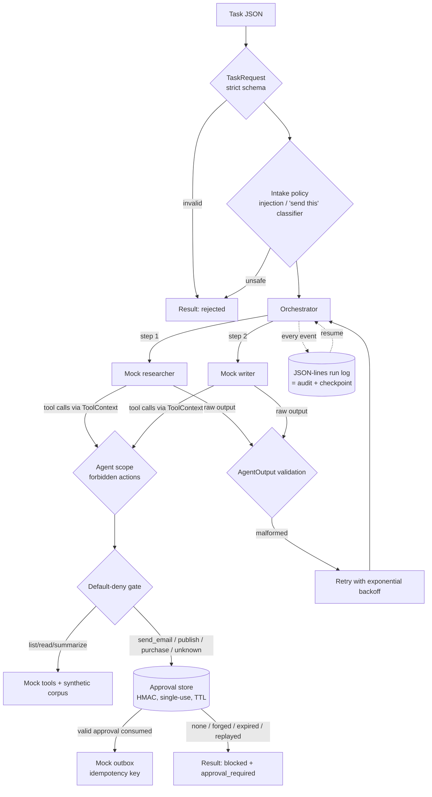

# Jarvis Agentic Workforce



<sub>~69 s, recorded from real CLI runs (mock agents, synthetic data) with `python3 scripts/record_demo.py`;
also available as an asciicast: `docs/media/demo.cast`.</sub>

An offline, test-first multi-agent orchestrator built with safety from the start. An orchestrator hands a task to
mock **researcher** and **writer** agents. **Every tool call passes a default-deny gate.** Consequential actions
(send email, publish, purchase) need a **single-use, expiring, HMAC-signed human approval** bound to the exact
request. Every agent output is validated as untrusted. Every decision goes to a JSON-lines log, which also serves
as the **checkpoint**: a crashed run resumes without repeating work or side effects.

It is a clean, public rebuild of patterns from an earlier private prototype. Two small, generic components (the
intake classifier and per-agent scope) were adapted from it. No data, logs, prompts, credentials or configuration
from the prototype are included; see `docs/design-lineage.md`.

> **Status (v0.2.0):** Phases 1-3 are implemented and tested: 73 tests, all offline. Everything runs on **mock
> agents (no LLM)**, **mock tools** and a **synthetic corpus**. Nothing is deployed, nothing touches a real
> account, and the package contains no network code. Real LLM backends and AWS deployment are **planned**
> (`docs/roadmap.md`).

## Quickstart (standard library only; tested on Linux with Python 3.13, code targets 3.10+)
```bash
./scripts/test.sh -v          # full suite, network-blocked (unshare -rn if available, plus a Python socket guard)
./scripts/demo.sh             # all demo scenarios with a readable run trace
./scripts/demo.sh --scenario crash     # research | blocked | approve | forged | faults | crash | injection
make test / make demo         # same commands via the Makefile
```
Without the wrappers: `PYTHONPATH=src python3 -m unittest discover -s tests` and `PYTHONPATH=src python3 -m jarvis_workforce.demo`.

### Human-in-the-loop flow with persistent state
```bash
cp .env.example .env && chmod 600 .env    # then set JARVIS_APPROVAL_KEY (generation command is inside the file)
export PYTHONPATH=src
python3 -m jarvis_workforce.run     --workdir ./var --task examples/tasks/research_and_email.json   # -> blocked (exit 10)
python3 -m jarvis_workforce.approve --workdir ./var --run demo-email-001          # shows the exact request
python3 -m jarvis_workforce.approve --workdir ./var --run demo-email-001 --yes    # approve it (single-use, 10 min)
python3 -m jarvis_workforce.run     --workdir ./var --task examples/tasks/research_and_email.json   # resumes, mock email sent
```
If no key is configured, the gate has no approval store and every consequential action is denied (fail closed).

## Architecture


## What is implemented (and tested)
| Area | Module | Tests |
|---|---|---|
| Orchestrator: researcher → writer → optional delivery, status machine | `orchestrator.py` | `test_workflow.py` |
| Default-deny gate, request hash binding, spoofing detection | `gate.py` | `test_workflow.py` |
| Approval store: HMAC-SHA256, single-use nonce, expiry, tamper/replay/wrong-key rejection, file lock | `approval_store.py` | `test_approvals.py` |
| Key from env or `.env` (must be mode 0600), fail closed | `approval_store.load_key` | `test_approvals.py` |
| Validated models (task, agent output, result) | `models.py` | `test_workflow.py` |
| Retries + exponential backoff (transient errors, malformed output); permanent errors fail fast | `orchestrator.py` | `test_workflow.py` |
| JSON-lines log as checkpoint; resume; idempotency keys; crash-before-commit recovery | `runlog.py`, `orchestrator.py`, `tools.py` | `test_recovery.py` |
| Intake classifier (EN/PT/NO, homoglyph/leet/spacing normalisation), ported | `policy.py` | `test_policy.py` |
| Per-agent folder isolation + forbidden actions, ported | `scope.py` | `test_scope.py` |
| Offline runner (netns + socket guard) | `scripts/run_offline.sh` | `test_offline.py` |
| CLIs: demo, run, approve | `demo.py`, `run.py`, `approve.py` | `test_demo.py`, `test_recovery.py` |
| Secret/private-data scan of the repo tree | | `test_secret_scan.py` |

## Planned (not built)
Real LLM backend behind the gate · off-host approval signer (Ed25519/KMS) · OS-level agent isolation · AWS deployment.
See `docs/roadmap.md`.

## Layout
```
src/jarvis_workforce/   orchestrator, gate, approval_store, models, agents, tools, runlog, policy, scope, demo/run/approve CLIs
tests/                  unittest suite (73 tests)
examples/               synthetic corpus (4 notes) + task files
scripts/                run_offline.sh, test.sh, demo.sh, record_demo.py (README GIF), offline/sitecustomize.py (socket guard)
docs/media/             demo.gif, demo.cast, demo_frame.png
docs/                   architecture, security, decisions, roadmap, design-lineage
.github/workflows/      GitHub Actions: offline test suite + demo smoke run (Python 3.10/3.12/3.13)
```

## License
MIT, see `LICENSE`.
