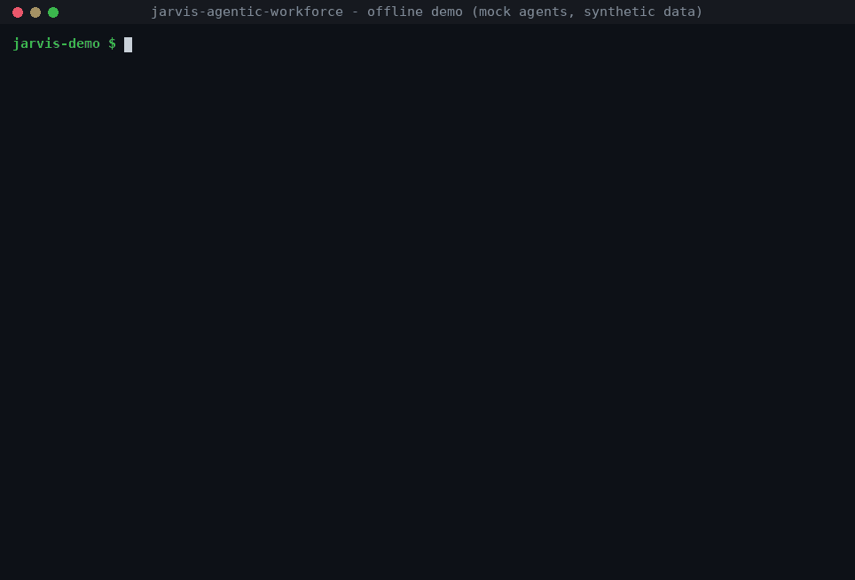
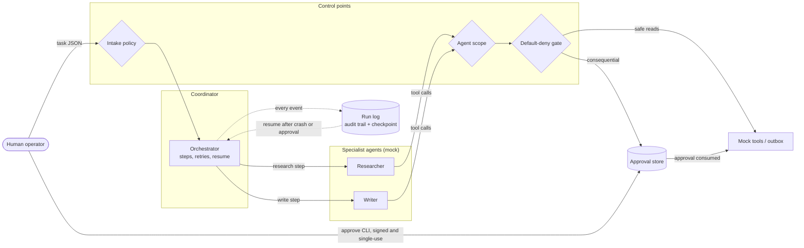
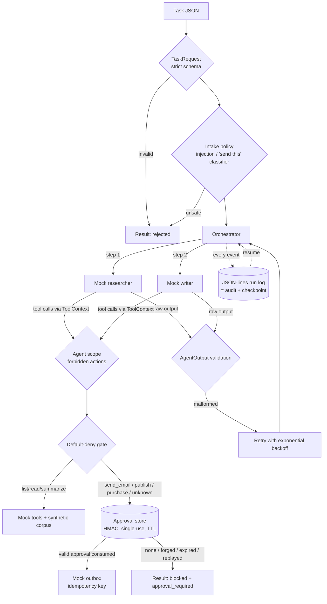
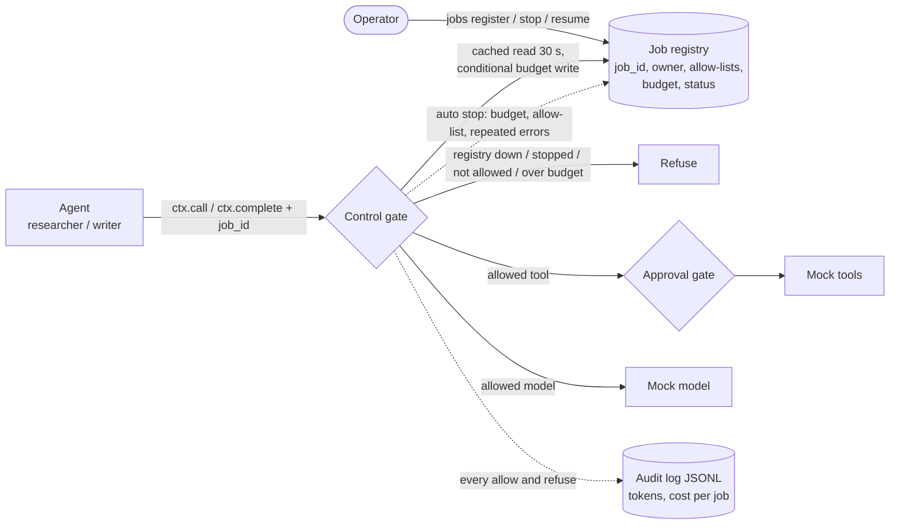

# Jarvis Agentic Workforce



<sub>~69 s, recorded from real CLI runs (mock agents, synthetic data) with `python3 scripts/record_demo.py`;
also available as an asciicast: `docs/media/demo.cast`.</sub>

An offline, test-first multi-agent orchestrator built with safety from the start. An orchestrator hands a task to
mock **researcher** and **writer** agents. **Every tool call passes a default-deny gate.** Consequential actions
(send email, publish, purchase) need a **single-use, expiring, HMAC-signed human approval** bound to the exact
request: the action, its parameters, and the run and task it belongs to. Every agent output is validated as
untrusted. Every decision goes to a JSON-lines log, which also serves
as the **checkpoint**: a crashed run resumes without repeating work or side effects.

It is a clean, public rebuild of patterns from an earlier private prototype. Two small, generic components (the
intake classifier and per-agent scope) were adapted from it. No data, logs, prompts, credentials or configuration
from the prototype are included; see `docs/design-lineage.md`.

> **Status (v0.3.0):** Phases 1-3 and the workload control layer are implemented and tested: 119 tests, all offline. Everything runs on **mock
> agents (no LLM)**, **mock tools** and a **synthetic corpus**. Nothing is deployed, nothing touches a real
> account, and the package contains no network code. Real LLM backends and AWS deployment are **planned**
> (`docs/roadmap.md`).

## Quickstart
Standard library only, nothing to install. Needs Python 3.10+ and a POSIX shell (Linux, macOS or WSL); CI runs
Python 3.10, 3.12 and 3.13. Full step-by-step setup, exit codes and troubleshooting: [`docs/setup.md`](docs/setup.md).
```bash
git clone https://github.com/antequeradiogo-stack/jarvis-agentic-workforce.git && cd jarvis-agentic-workforce
./scripts/test.sh -v          # full suite, network-blocked (unshare -rn if available, plus a Python socket guard)
./scripts/demo.sh             # all demo scenarios with a readable run trace
./scripts/demo.sh --scenario crash     # research | blocked | approve | forged | faults | crash | injection | control
make test / make demo         # same commands via the Makefile
```
Without the wrappers: `PYTHONPATH=src python3 -m unittest discover -s tests` and `PYTHONPATH=src python3 -m jarvis_workforce.demo`.

### Human-in-the-loop flow with persistent state
```bash
cp .env.example .env && chmod 600 .env    # then set JARVIS_APPROVAL_KEY (generation command is inside the file)
export PYTHONPATH=src
python3 -m jarvis_workforce.run     --workdir ./var --task examples/tasks/research_and_email.json   # -> blocked (exit 10)
python3 -m jarvis_workforce.approve --workdir ./var --run demo-email-001          # shows the exact request
python3 -m jarvis_workforce.approve --workdir ./var --run demo-email-001 --yes    # approve it (single-use, 10 min)
python3 -m jarvis_workforce.run     --workdir ./var --task examples/tasks/research_and_email.json   # resumes, mock email sent
```
If no key is configured, the gate has no approval store and every consequential action is denied (fail closed).
`run` exits 0 when completed, 10 when blocked on an approval, 1 on failure and 2 when the task is rejected.

## Architecture
### Who does what
The orchestrator is the coordinator: it owns the task, hands each step to a specialist agent and decides what
happens next. Agents never call tools directly, and only a human can approve a consequential action.


### Request flow


## Workload control: isolate, limit and stop agent jobs
This section is written from a junior cloud engineer's point of view. Before agents run on shared
infrastructure, four questions need an answer: which job is this call for, what may it touch, how much may it
spend, and how fast can it be stopped? The design follows OpenAI's [Control Room](https://openai.com/index/control-room) write-up (9 Nov 2026). Here it runs
offline on a local JSON file; the AWS mapping is below and in [`docs/aws-control-plane.md`](docs/aws-control-plane.md).

1. **Every job is registered.** A job has a `job_id`, an `owner`, an allow-list of tools and models, a budget cap
   (USD and/or tokens) and a status, `active` or `stopped` (`control.JobRegistry`).
2. **One gate checks every call.** Agents never hold a model client or a tool box. They call `ctx.call()` (tools)
   and `ctx.complete()` (model), and both go through `control.ControlGate` before the existing approval gate.
   A run started without a `job_id` is refused on its first call.
3. **Fail closed.** If the registry is missing, unreadable or corrupt, every call is refused. If an allow cannot
   be written to the audit log, it is refused too.
4. **A stop takes effect within the cache window.** Registry reads are cached for 30 s (`JARVIS_REGISTRY_TTL_S`,
   0 to 300). A stop from the kill switch therefore reaches a running gate within the TTL at most. Model calls
   also reserve budget with a conditional write that re-checks the status, so a stopped job cannot spend more
   model budget inside that window. Automatic stops apply at once.

**Automatic stop rules** (each one can be switched off): a budget overrun, a tool or model outside the allow-list,
or 3 errors in a row. **Audit:** `control/audit.jsonl` gets one line for every allow or refuse, plus usage lines
(timestamp, job, run, agent, model or tool, tokens, cost, decision, reason). `jobs costs` adds these up per job.
Model prices in `llm.py` are illustrative numbers for the offline mock, not a provider's real prices.

```bash
export PYTHONPATH=src R=./var/control/jobs.json
python3 -m jarvis_workforce.jobs --registry $R init
python3 -m jarvis_workforce.jobs --registry $R register demo-job-001 --owner ops \
    --tools list_docs,read_doc --models mock-small --budget-usd 0.01 --budget-tokens 20000
python3 -m jarvis_workforce.run  --workdir ./var --task examples/tasks/research_only.json --job demo-job-001
python3 -m jarvis_workforce.jobs --registry $R stop demo-job-001 --reason "incident drill"   # kill switch
python3 -m jarvis_workforce.jobs --registry $R costs                                          # cost per job
./scripts/demo.sh --scenario control     # registered run -> stop (cached, then refused) -> registry down
```



### AWS path (designed, not deployed)
| Concern | Here (offline) | On AWS |
|---|---|---|
| Job registry | `jobs.json` with a file lock | DynamoDB table `jarvis-jobs`, partition key `job_id`, on-demand |
| Budget check | `charge()` under the lock | `UpdateItem` with `ADD` and a `ConditionExpression` (status active, within cap) |
| One gate | `ControlGate` in `ToolContext` | A gate Lambda. Only its role may call `bedrock:InvokeModel`; agent roles may only invoke the gate |
| Cache, stop delay | 30 s in-process cache | In-memory cache per warm Lambda environment; same worst case, the TTL |
| Fail closed | registry error means refuse | DynamoDB error or timeout means refuse; agents have no other way to reach a model |
| Kill switch | `jobs stop` | `UpdateItem SET status = stopped` from an operator role (MFA); a DynamoDB backend for `jobs` is planned, not built |
| Isolate | per-agent folder scope and forbidden actions | one IAM role per agent Lambda, reserved concurrency, short timeouts |
| Audit, cost | `audit.jsonl`, `jobs costs` | structured JSON lines in CloudWatch Logs, a Logs Insights query for cost per job, alarms on refusals |
| Account backstop | none | AWS Budgets alarm, set before the first deploy |

**IAM least privilege.** Agent roles get `lambda:InvokeFunction` on the gate only: no Bedrock and no DynamoDB
access. The gate role gets `dynamodb:GetItem` and `dynamodb:UpdateItem` on the one table, `bedrock:InvokeModel`
on named model ARNs, and permission to write to its own log group. The operator role is the only one that can
register, stop and resume jobs. None of this is deployed, and this repo makes no AWS calls.

## What is implemented (and tested)
| Area | Module | Tests |
|---|---|---|
| Orchestrator: researcher → writer → optional delivery, status machine | `orchestrator.py` | `test_workflow.py` |
| Default-deny gate, request hash binding (action, params, run, task), spoofing detection | `gate.py` | `test_workflow.py` |
| Approval store: HMAC-SHA256, single-use nonce, expiry, tamper/replay/wrong-key rejection, file lock | `approval_store.py` | `test_approvals.py` |
| Key from env or `.env` (must be mode 0600), fail closed | `approval_store.load_key` | `test_approvals.py` |
| Validated models (task, agent output, result) | `models.py` | `test_workflow.py` |
| Retries + exponential backoff (transient errors, malformed output); permanent errors fail fast | `orchestrator.py` | `test_workflow.py` |
| JSON-lines log as checkpoint; resume; idempotency keys; crash-before-commit recovery | `runlog.py`, `orchestrator.py`, `tools.py` | `test_recovery.py` |
| Intake classifier (EN/PT/NO, homoglyph/leet/spacing normalisation), ported | `policy.py` | `test_policy.py` |
| Per-agent folder isolation + forbidden actions, ported | `scope.py` | `test_scope.py` |
| Offline runner (netns + socket guard) | `scripts/run_offline.sh` | `test_offline.py` |
| CLIs: demo, run, approve, jobs | `demo.py`, `run.py`, `approve.py`, `jobs.py` | `test_demo.py`, `test_recovery.py`, `test_control.py` |
| Secret/private-data scan of the repo tree | | `test_secret_scan.py` |
| Workload control: job registry, one control gate for every model and tool call, fail closed, 30 s cache, kill switch, auto-stop rules, audit log, cost per job | `control.py`, `llm.py`, `jobs.py` | `test_control.py` |

## Planned (not built)
Real LLM backend behind the gate · off-host approval signer (Ed25519/KMS) · OS-level agent isolation · AWS deployment.
See `docs/roadmap.md`.

## Layout
```
src/jarvis_workforce/   orchestrator, gate, control, llm, approval_store, models, agents, tools, runlog, policy, scope, demo/run/approve/jobs CLIs
tests/                  unittest suite (119 tests)
examples/               synthetic corpus (4 notes) + task files
scripts/                run_offline.sh, test.sh, demo.sh, record_demo.py (README GIF), offline/sitecustomize.py (socket guard)
docs/media/             demo.gif, demo.cast, demo_frame.png
docs/                   setup, architecture, security, decisions, roadmap, design-lineage
.github/workflows/      GitHub Actions: offline test suite + demo smoke run (Python 3.10/3.12/3.13)
```

## Documentation
- [`docs/setup.md`](docs/setup.md): setup, running the tests and demo, the approval flow, exit codes
- [`docs/architecture.md`](docs/architecture.md): flow, gate, run log as checkpoint, components
- [`docs/security.md`](docs/security.md): permissions model, controls and their limits
- [`docs/decisions.md`](docs/decisions.md): design decisions and trade-offs
- [`docs/aws-control-plane.md`](docs/aws-control-plane.md): workload control on AWS (DynamoDB job registry, gate Lambda, IAM, CloudWatch)
- [`docs/roadmap.md`](docs/roadmap.md): planned work (real LLM backend, AWS deployment)
- [`docs/design-lineage.md`](docs/design-lineage.md): what came from the earlier private prototype

## License
MIT, see `LICENSE`.
