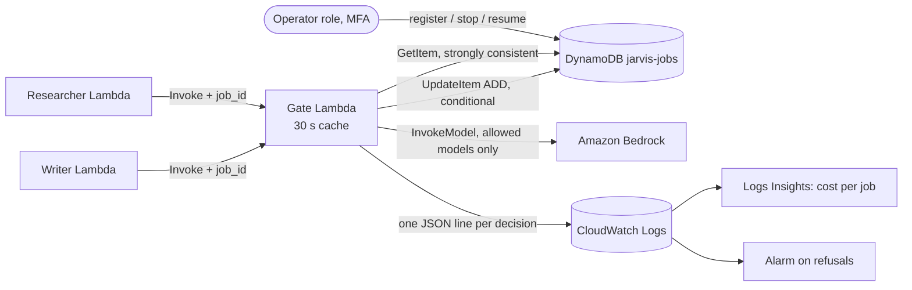

# Workload control on AWS: job registry in DynamoDB (design, not deployed)

The offline control layer (`src/jarvis_workforce/control.py`) is built so it can move to AWS without changing
its rules. This page describes that path. Nothing here is deployed, and the repo makes no AWS calls.

## Rules that do not change
1. Every agent job has a registered `job_id`, an owner, allow-lists, a budget cap and a status.
2. One gate checks every model and tool call. Agents cannot reach a model any other way.
3. Fail closed: if the registry cannot be read, the gate refuses.
4. A stop takes effect within the gate's cache TTL (default 30 s).

## Components
| Component | AWS service | Notes |
|---|---|---|
| Job registry | DynamoDB table `jarvis-jobs` (on-demand) | one item per job; deletion protection on; point-in-time recovery optional |
| Gate | Lambda `jarvis-gate` | the only role with `bedrock:InvokeModel`; holds the 30 s cache per warm environment |
| Agents | one Lambda per agent (`researcher`, `writer`) | invoke the gate only; no model, table or delivery permissions |
| Kill switch | `jobs stop` CLI under an operator role (MFA) | a plain conditional `UpdateItem` on the table |
| Audit, cost | CloudWatch Logs (structured JSON), Logs Insights | optional archive to S3 with Object Lock |
| Account backstop | AWS Budgets alarm | per-job caps live in the table; the account alarm catches everything else |



## Table design: `jarvis-jobs`
- **Partition key:** `job_id` (String). No sort key: every lookup is by job, and a single item keeps the
  status and the spend counters together, so one conditional write checks both.
- **Capacity:** on-demand (no capacity planning, pay per request, nothing to pay while idle).

| Attribute | Type | Meaning |
|---|---|---|
| `job_id` | S | registered ID, `[A-Za-z0-9][A-Za-z0-9_.-]{2,63}` |
| `owner` | S | who is responsible for the job |
| `status` | S | `active` or `stopped` |
| `allowed_tools` | SS | tool allow-list |
| `allowed_models` | SS | model allow-list (Bedrock model IDs on AWS) |
| `budget_micro_usd` | N | USD cap in millionths (integers avoid float drift); absent means no USD cap |
| `budget_tokens` | N | token cap; absent means no token cap |
| `spent_micro_usd`, `spent_tokens` | N | running totals, changed only with `ADD` |
| `stop_reason` | S | set on stop, for example `auto: token budget exceeded` |
| `created_at`, `updated_at` | S | ISO 8601 UTC |
| `version` | N | incremented on every write |

Optional GSI `status-updated_at` (partition `status`, sort `updated_at`) lists active or recently stopped jobs
without a scan.

## Operations
`status` is a DynamoDB reserved word, so the expressions use `#s` with `ExpressionAttributeNames {"#s": "status"}`.

**Register.** `PutItem` with `ConditionExpression: attribute_not_exists(job_id)`, so an existing job is never
overwritten.

**Read (the gate, on a cache miss).** `GetItem` with `ConsistentRead: true`. A strongly consistent read means a
stop is seen as soon as the cached entry expires. Any error, throttle or timeout means refuse.

**Reserve budget before a model call.** DynamoDB condition expressions cannot do arithmetic. So the gate works
out the highest allowed current spend, `cap - cost`, from the item it has just read:
```
UpdateExpression:    ADD spent_tokens :t, spent_micro_usd :c, version :one  SET updated_at = :now
ConditionExpression: #s = :active
                     AND (attribute_not_exists(budget_tokens)    OR spent_tokens    <= :tokens_limit)
                     AND (attribute_not_exists(budget_micro_usd) OR spent_micro_usd <= :usd_limit)
ReturnValuesOnConditionCheckFailure: ALL_OLD
```
Here `:tokens_limit = budget_tokens - :t` and `:usd_limit = budget_micro_usd - :c`. If operators can change a cap
after registration, also add `AND budget_tokens = :budget_tokens_seen` (and the same for USD), so the write fails
when the cap changed after the gate read it.
`ConditionalCheckFailedException` means refuse. The returned old item shows whether the job was stopped or over
budget, so the gate can apply the automatic stop rule without another read.

**Settle after the call.** `UpdateItem ADD spent_tokens :delta, spent_micro_usd :delta_usd`, with no condition.
The delta (actual minus reserved) is usually negative. If settling fails, the reservation stays charged: counting
too much is the safe direction.

**Stop (kill switch) and resume.** `UpdateItem SET #s = :stopped, stop_reason = :r, updated_at = :now ADD
version :one` with `ConditionExpression: attribute_exists(job_id)`, so a typo never creates a new item. Resume
sets `#s = :active` and removes `stop_reason`.

## Stop delay
Each warm gate environment caches a job for at most the TTL. In the worst case, a stop reaches every environment
within **TTL seconds** (30 s by default; 0 turns the cache off). Model calls are also checked by the conditional
reservation, so a stopped job cannot reserve more model budget even inside the window. A lower TTL means more
`GetItem` reads; at portfolio traffic that is still far below a cent per day.

## IAM least privilege
- **Agent roles:** `lambda:InvokeFunction` on `jarvis-gate` only. No `bedrock:*`, no `dynamodb:*`, no `ses:*`.
  This is what makes "agents never call models directly" true at the platform level, and not only in code.
- **Gate role:** `dynamodb:GetItem` and `dynamodb:UpdateItem` on the `jarvis-jobs` table ARN only;
  `bedrock:InvokeModel` on the named model ARNs; `logs:CreateLogStream` and `logs:PutLogEvents` on its own log
  group. No `PutItem`, `DeleteItem` or `Scan`.
- **Operator role (MFA required):** `dynamodb:PutItem`, `UpdateItem`, `GetItem`, `Query` on the table.
- Deny the table's `DeleteTable` to everyone except an infrastructure role used by reviewed IaC (SAM/CDK) deploys.

## Audit and cost per job in CloudWatch
The gate writes one JSON line per decision with the same fields as `audit.jsonl` (`ts`, `event`, `job_id`,
`run_id`, `agent`, `kind`, `model`, `tool`, `decision`, `reason`, `tokens`, `cost_usd`). Cost per job in Logs Insights:
```
fields job_id, tokens, cost_usd
| filter event = "usage"
| stats sum(cost_usd) as usd, sum(tokens) as tokens, count(*) as calls by job_id
| sort usd desc
```
Use a metric filter on `decision = "refuse"` for one alarm without a job dimension. A per-job metric dimension
would create a custom metric for each job, and custom metrics are billed per metric.

## Isolation and limits
- One Lambda and one IAM role per agent; reserved concurrency limits how many copies of a job can run at once.
- Short Lambda timeouts and a `max_tokens` on every model request.
- No VPC or NAT Gateway: nothing here needs one, and a NAT Gateway is the usual surprise cost.
- An AWS Budgets alarm (for example USD 5) set **before** the first deploy.

## Cost note (estimate, not a quote)
At portfolio traffic, DynamoDB on-demand, Lambda and CloudWatch Logs for this control plane are expected to cost
cents per month, and partly fall in the free tier. Model tokens are the main variable cost, and the per-job
budget caps limit them.
